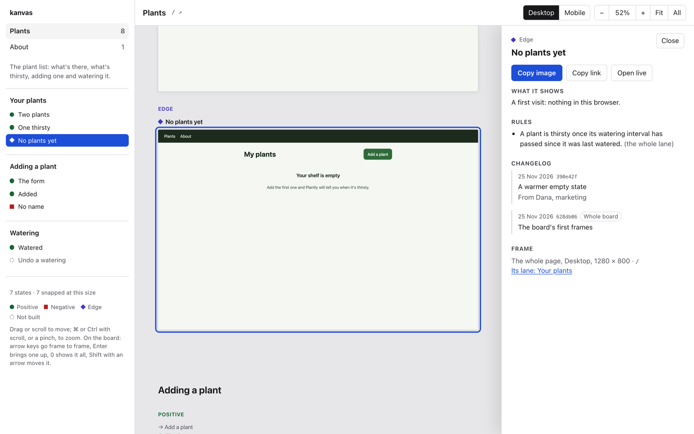

# kanvas

Every state of your app on one board, as static frames, each with its rules and its changelog.



kanvas opens your running app in a headless browser, puts each page in each state you describe (what the browser holds first, a few clicks), and freezes it into a static HTML+CSS frame with its images. The frames sit on a board, the way a design file would lay them out: a board per page or flow, a lane per story, a row per kind of state (positive, negative, edge), an arrow from a state to the one an action leads to. Click a frame for the rules it follows and what changed in it, commit by commit, and who asked.

It's made for apps built with a coding agent. The agent keeps the list of states as it builds, so the board stays a true map of the app, and each frame's rules and changelog are the memory an AI-built app usually loses.

**Early days (0.1).** It works on real apps; the config may still change before 1.0.

## Start

```sh
npm i -D kanvasboard
npx kanvas init     # a kanvas.config.ts from your app's pages, and your agent's instructions
npm run dev         # kanvas opens the app where it runs
npx kanvas snap     # every scene at every screen size, frozen into kanvas/
npx kanvas view     # the board, in your browser
```

`init` finds your pages (Next.js, Nuxt, Astro and SvelteKit routes; in other apps, the paths their code links to) and the port your dev server answers on. It writes a starting board, "Pages", with each page as it first opens: replace it as you add real lanes. And it writes a block into `AGENTS.md` that tells your coding agent to keep the board up to date, with a `CLAUDE.md` that reads it if you have none, so Claude Code sees it too. Then ask the agent for the states that matter: an empty list, an error, a dialog open.

The first time, commit the config and the agent file, then snap and commit `kanvas/` on its own, as below.

Needs Node 20 or later and Google Chrome. Without Chrome: `npx playwright-core install chromium`, then add `--browser chromium` to each command.

## Describe a state

A **scene** is one state of the app and how to reach it:

```ts
{
  id: "add-no-name",
  title: "No name",
  path: "/",
  // what the browser holds before the page loads
  seed: { localStorage: { "plantly:plants": JSON.stringify(twoPlants) } },
  // what to do on the page, in order
  steps: [
    { click: "Add a plant" },
    { click: { role: "button", name: "Add plant" } },
    { see: { text: "Give your plant a name." } },
  ],
  // the whole page, one screen (a dialog, a sheet, a toast), or one section of a long page
  view: "screen",
  from: "add-open",          // the state it follows: an arrow on the board
  via: "Add plant, empty",   // the action, written on the arrow
  rules: ["A plant needs a name."],
}
```

- **Seed**: `localStorage`, `sessionStorage` and `cookies`. A function is called at the board's clock, so dates it works out (`Date.now() - 2 * DAY`) match the page's.
- **Steps**: `click`, `fill` (with `text`), `select` (with `option`, for a `<select>`), `leave`, `see`, `show`, `press`, `top`, `wait`, `hold`. A target is the words on a button or link, or `{ role, name }`, `{ label }`, `{ text }`, `{ placeholder }`, `{ css }`, found the way a person finds them; `contains: true` matches part of the words.
- **Arrows**: `from` names the state this one follows, on any lane or board. Without it, a scene follows the one before it in its row, so give `from: null` to a state that doesn't follow anything.
- **Frozen time**: every scene runs at the config's `clock`, so "2 days ago" says the same thing on every snapshot.
- **A state that's asked for but not built** is a gap, `{ id, title, gap: true }`: a dashed placeholder on the board.

Scenes go in rows, rows in lanes, lanes in boards. [`kanvas.config.example.ts`](kanvas.config.example.ts) is a whole config, and [docs/config.md](docs/config.md) has every field.

## After each change

Frames follow main, not work in progress. After a commit to main that changes what a page shows, with the app running:

```sh
npx kanvas check    # every scene can still be reached
npx kanvas snap     # fresh frames
npx kanvas log      # changelog entries for the frames that look different
git add kanvas && git commit -m "chore(kanvas): frames for the empty state"
```

Only frames that look different get an entry: their words changed, or their picture did. A change across most of a board (a header, a colour) is one entry for the whole board. Who asked for a change comes from a `Source:` trailer in its commit, or the ticket it names (`PROJ-293`):

```text
fix(plants): a warmer empty state

Source: Dana, marketing
```

`kanvas diff` says which frames changed without writing anything. Your coding agent does all of this when `init`'s instructions are in its file.

When a scene can't be reached (a button its steps press was renamed), `snap` says which step failed and exits 1, and the scene keeps the last frame that did reach it, marked on the board; `log` leaves it out until it's fixed. A new scene that has never been reached shows where it stopped.

## Share the board

`kanvas view` needs nothing built. To put the board somewhere, `kanvas build` copies the board's viewer next to the frames: into the frames' folder by default, or `--to <dir>`.

- **Served by the app itself**: point `out` at a folder the app serves as files, such as `public/kanvas`, and add `kanvas build` after `snap` in the routine. Commit what it writes: the board is at `/kanvas/index.html` on every deployment.
- **On any static host**: `kanvas build --to site` and publish `site`; leave it out of the repo. Set `site` in the config to the app's address so the board's links to pages go there.

**Open live** puts the real app in a frame's state. From `kanvas view` it always can: it opens a browser on your machine and plays the scene. On a built board it needs the app's help: if the app can put itself in a scene from a query parameter, set `live: { query: "scene" }` and Open live links there; otherwise the drawer gives the `kanvas open <scene>` command.

## In CI

`kanvas check` exits 1 when a scene can no longer be reached, because a step's button was renamed or removed. On GitHub Actions:

```yaml
- run: npm ci
- run: npx playwright-core install --with-deps chromium
- run: npm run dev &
- run: npx wait-on http://localhost:3000
- run: npx kanvas check --browser chromium
```

## Commands

| Command | Does |
| --- | --- |
| `kanvas init` | A starting `kanvas.config.ts` and your agent's instructions (`--force` rewrites the config) |
| `kanvas snap [board…]` | Opens each scene at each device and freezes it (`--scene`, `--device` to narrow) |
| `kanvas view` | The board on this machine, with Open live |
| `kanvas open <scene>` | That scene in a real browser window, in its state, to use |
| `kanvas build` | The board as a static site (`--to <dir>`) |
| `kanvas check` | Fails when a scene can't be reached |
| `kanvas diff` | Which frames look different from the ones last committed |
| `kanvas log` | Changelog entries for them (`--summary`, `--source` to say it yourself) |
| `kanvas verify` | Each frozen frame against the live page's picture |

`snap` writes `kanvas/manifest.json` (the boards and every frame), `kanvas/frames/` (each frame's HTML, a PNG and a small WebP), and `kanvas/assets/` (images, fonts and stylesheets, shared by content). Commit them: the changelog's history is your repo's.

## How it works

Each scene opens in Chrome through Playwright, with its storage seeded and only `Date` moved to the board's clock. After its steps, animations are settled at their end, and the page is serialized: the DOM with its form state and focus, its stylesheets with viewport units made fixed, its images and fonts saved beside it. A frame is that HTML with no scripts, shown in a sandboxed frame. Zoomed out, the board shows small pictures instead, so a board of a hundred frames stays light. What can't be frozen faithfully (a `<canvas>`, a video, a map) makes its frame fall back to its picture.

[docs/plan.md](https://github.com/hirahorc/kanvasboard/blob/main/docs/plan.md) has the decisions behind it and what's next.

## Licence

MIT
